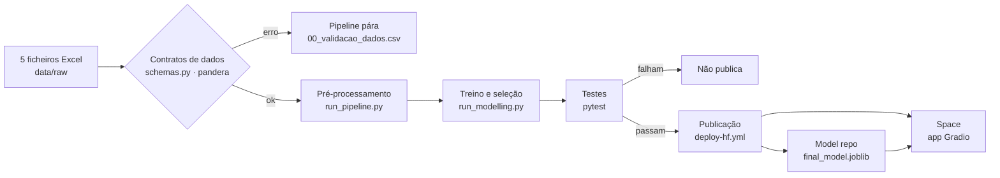

<p align="center">
  
  
  
</p>

# Telco Customer Churn — Retention Management

Projeto de grupo da cadeira **Enterprise Data Science Bootcamp (EDSB 2026)** da NOVA IMS.

O objetivo é construir um sistema que ajude o *Head of Customer Retention* a decidir **que clientes devem receber uma intervenção de retenção** e **com que prioridade**. A base é a estimativa do risco de churn, combinada com o valor do cliente (CLTV). Um churn score isolado não é o objetivo.

---

## Fluxo do projeto



| Passo | Onde | Quando corre |
|---|---|---|
| Validação dos dados (contratos) | `src/telco_churn/schemas.py`, chamada em `data.load_raw` e `data.merge_datasets` | Sempre que os dados são lidos |
| Pré-processamento e modelação | `scripts/run_all.py --sem-profiling` | Localmente e no `deploy-hf.yml` |
| Testes | `tests/` (pytest) | Em cada push/PR (`ci.yml`) e antes de publicar (`deploy-hf.yml`) |
| Publicação | `scripts/publish_hf.py` | `deploy-hf.yml`: manual ou em push para `main`, **só se a pipeline e os testes passarem** |

**App:** _link do Space a acrescentar depois da primeira publicação_ (`https://huggingface.co/spaces/<conta>/<space>`).

---

## Dataset

Amostra IBM *Telco Customer Churn*: 7.043 clientes na Califórnia, com um único snapshot do Q3.

| Ficheiro | Grão | Chave de ligação |
|---|---|---|
| `Telco_customer_churn_demographics.xlsx` | 1 linha por cliente | `Customer ID` |
| `Telco_customer_churn_location.xlsx` | 1 linha por cliente | `Customer ID` |
| `Telco_customer_churn_services.xlsx` | 1 linha por cliente | `Customer ID` |
| `Telco_customer_churn_status.xlsx` | 1 linha por cliente | `Customer ID` |
| `Telco_customer_churn_population.xlsx` | 1 linha por ZIP code | `Zip Code` |

- **População de modelação:** clientes `Churned` + `Stayed` (6.589). Os `Joined` (454) ficam fora do modelo core.
- **Artefacto dos clientes novos:** os Joined têm todos 1–3 meses de casa, por isso dentro de Churned + Stayed todos os clientes com tenure ≤ 3 saíram. Além do modelo core, há um **modelo de priorização** treinado só com tenure > 3, e os clientes novos são tratados por uma **regra de onboarding** (ver `docs/modelling.md`).
- **Target:** `churn` = 1 se *Churned*, 0 se *Stayed* (taxa de 28,4%).
- **Avaliação:** holdout estratificado 80/20 ao nível do cliente.

Fonte: [IBM Cognos Analytics — Telco Customer Churn](https://www.ibm.com/docs/en/cognos-analytics/12.0.x?topic=samples-telco-customer-churn). O guia do projeto está em `reports/project_guide.pdf`.

---

## Estrutura do repositório

```
telco-churn-retention/
├── data/
│   ├── raw/                  # 5 ficheiros Excel originais (não editar)
│   └── processed/            # train/test/joined gerados pelo pipeline (git-ignored)
├── notebooks/
│   ├── 01_preprocessing_eda.ipynb   # EDA e pré-processamento, documentado por secções
│   ├── 01b_profiling_ydata.ipynb    # relatórios ydata-profiling
│   └── 02_modelling_eda.ipynb       # modelos, benchmark IBM, modelo de priorização e decisões de retenção
├── docs/
│   ├── models.md             # como funciona cada modelo, hiperparâmetros e papel no projeto
│   ├── modelling.md          # protocolo de avaliação, seleção, métricas, gráficos e decisões
│   └── revisao_complexidade.md  # revisão de complexidade do código (antes/depois)
├── src/telco_churn/          # código reutilizável
│   ├── config.py             # caminhos, seed, % de teste
│   ├── style.py              # paleta, tema dos gráficos, tabelas formatadas
│   ├── schemas.py            # contratos de dados (pandera): esquema, chaves, domínios, regras
│   ├── data.py               # carregar (com validação), unir, qualidade
│   ├── features.py           # população, papéis das variáveis, feature engineering
│   ├── analysis.py           # perfis, Cramér's V, Mutual Information
│   ├── plots.py              # gráficos da EDA
│   ├── profiling.py          # relatórios ydata-profiling com a paleta do projeto
│   ├── preprocessing.py      # split, ColumnTransformers, exportação
│   ├── modelling.py          # modelos, tuning em CV, ensembles, métricas, holdout, P(churn) × CLTV
│   ├── retention.py          # P vs P × CLTV, custo-benefício, ações sugeridas, regra de onboarding
│   ├── scoring.py            # usar o modelo: cliente, lote, fatores e decisão de desconto
│   └── model_plots.py        # gráficos da modelação
├── scripts/
│   ├── run_pipeline.py       # pré-processamento e EDA sem notebook
│   ├── run_profiling.py      # relatórios ydata-profiling
│   ├── run_modelling.py      # modelação completa sem notebook
│   ├── run_all.py            # corre os três, por ordem
│   └── publish_hf.py         # publica o modelo e a app no Hugging Face (usado pelo deploy)
├── tests/                    # pytest: dados, pré-processamento, modelo e app
├── app/                      # app Gradio (Hugging Face Space): app.py, requirements, README
├── MODEL_CARD.md             # model card publicado com o modelo
├── outputs/                  # figuras, tabelas, artefactos e profiling (git-ignored)
├── reports/                  # guia do projeto, status reports (pptx), dicionário de fontes
├── .vscode/                  # definições partilhadas do VS Code
├── .gitattributes            # nbstripout: remove os outputs dos notebooks em cada commit
├── requirements.txt          # dependências (versões mínimas)
├── requirements-lock.txt     # versões exatas usadas para gerar os resultados
├── pyproject.toml
└── README.md
```

---

## Como começar

### 1. Clonar e criar o ambiente

O repositório do grupo é [`j3grave/Bootcamp`](https://github.com/j3grave/Bootcamp); o projeto está na subpasta `telco-churn-retention`.

```bash
git clone https://github.com/j3grave/Bootcamp.git
cd Bootcamp/telco-churn-retention

python -m venv .venv
# Windows:      .venv\Scripts\activate
# macOS/Linux:  source .venv/bin/activate

pip install -r requirements-lock.txt   # mesmas versões com que os resultados foram gerados
# (ou pip install -r requirements.txt, para as versões mais recentes compatíveis)
pip install -e .          # opcional: torna `telco_churn` importável em qualquer lado
nbstripout --install      # obrigatório uma vez por membro: limpa os outputs dos notebooks em cada commit
```

### 2. Correr o pipeline

As fases correm por ordem, porque cada uma usa os ficheiros gerados pela anterior:

| Fase | No VS Code (kernel `.venv`, *Run All*) | Pela linha de comandos |
|---|---|---|
| 1. Pré-processamento e EDA | `notebooks/01_preprocessing_eda.ipynb` | `python scripts/run_pipeline.py` |
| 1b. Profiling (opcional) | `notebooks/01b_profiling_ydata.ipynb` | `python scripts/run_profiling.py` |
| 2. Modelação | `notebooks/02_modelling_eda.ipynb` | `python scripts/run_modelling.py` |

Para correr tudo de uma vez: `python scripts/run_all.py` (ou `--sem-profiling`, para saltar os relatórios). Para testar alterações à modelação depressa: `python scripts/run_modelling.py --rapido`.

### 3. Correr os testes

```bash
pytest                                   # todos (≈ 5 s; os do modelo precisam do passo 2)
pytest tests/test_data.py -v             # só os contratos de dados
```

| Ficheiro | O que testa |
|---|---|
| `tests/test_data.py` | Os ficheiros reais cumprem os contratos; derivações a 100%; merge 1:1; um valor fora do domínio (ex.: `Satisfaction Score = 9`) faz a pipeline parar |
| `tests/test_preprocessing.py` | Treino e teste disjuntos e estratificados; sem leakage nas features; sem NaN depois do pré-processador; `add_features` calculada linha a linha |
| `tests/test_model.py` | Sobre `final_model.joblib` e `priority_model.joblib`, sem retreinar: o lote separa clientes estabelecidos (modelo de priorização) e novos (lista de onboarding); cortes de capacidade sobre tenure > 3; bate a Dummy e a regra de negócio; não é pior do que o Churn Score IBM (AUC dentro do desvio-padrão da IBM em CV, PR AUC ≥, Brier <); sobreajuste < 0,05; aceita uma linha do formulário e devolve P em [0, 1] |
| `tests/test_app.py` | Decisão do desconto nos casos limite (P = 0, P = 1, custo = 0, eficácia = 0, empate, valores inválidos) |

### 4. Correr a app localmente

```bash
pip install gradio==6.31.0
python app/app.py        # abre em http://127.0.0.1:7860, com o modelo de outputs/artifacts/
```

A fase 1 gera:

- `data/processed/`: `train.csv`, `test.csv`, `joined_para_scoring.csv`, `telco_merged_full.csv`
- `outputs/figures/`: cerca de 40 gráficos da EDA
- `outputs/tables/`: perfis, dicionário de categorias, Cramér's V, Mutual Information
- `outputs/artifacts/preprocessing_config.joblib`: pré-processadores e listas de features

A fase 2 gera:

- `outputs/tables/10_*` a `21_*`: tuning, métricas em CV, variantes, holdout, importância, captura de valor, modelo de priorização, custo-benefício, ações sugeridas e regra de onboarding
- `outputs/figures/20_*` a `30_*`: comparação dos modelos, métricas por modelo, curvas, matrizes de confusão, rede neuronal, priorização e valor líquido por cenário
- `outputs/artifacts/final_model.joblib` (modelo core) e `priority_model.joblib` (modelo de priorização, tenure > 3)
- `data/processed/prioridade_holdout.csv`: lista de intervenção dos clientes estabelecidos do holdout, com a ação sugerida
- `data/processed/onboarding_joined.csv`: lista de onboarding dos Joined, por segmento

---

## Etapas do pipeline

| # | Etapa | O que faz |
|---|---|---|
| 1–2 | Setup e carregamento | Lê os Excel com `keep_default_na=False`, para preservar o literal `None` |
| 3 | Validação | Contratos de dados (ver [Data Contracts](#data-contracts)): esquema, chaves, domínios e regras de negócio; a pipeline pára se uma regra de erro falhar |
| 4 | União | Faz o merge com `validate="one_to_one"` / `"many_to_one"`, ficando 1 linha por cliente |
| 5 | Qualidade | Analisa missing e strings vazias e confirma as derivações documentadas |
| 6 | População e target | Exclui `Joined`, cria o target binário e documenta o artefacto do tenure ≤ 3 |
| 7 | Papéis das variáveis | Classifica cada coluna como id, leakage, benchmark, redundante, numérica ou categórica |
| 8 | Numéricas | Perfil (skew, % zeros, % outliers IQR), distribuições por target, Spearman |
| 9 | Categóricas | Dicionário de categorias, composição, Stayed vs Churned, Cramér's V |
| 10 | Associação e leakage | Mutual Information; verificação de Satisfaction Score e Churn Score |
| 11 | Feature engineering | `n_add_on_services`, `has_refund`, `avg_hist_charge`, `charge_delta` |
| 12 | Split e pré-processadores | Split 80/20 estratificado; `ColumnTransformer` *linear* e *trees* |
| 13 | Exportação | CSVs e `joblib` para a fase de modelação |

### Notebook 02 — modelação

Corre depois do notebook 01 (usa `data/processed/` e `preprocessing_config.joblib`). A explicação de cada modelo está em [`docs/models.md`](docs/models.md) e o protocolo de avaliação em [`docs/modelling.md`](docs/modelling.md).

| # | Etapa | O que faz |
|---|---|---|
| 3 | Modelos | Tabela dos modelos (família, pré-processador, funcionamento), a rede neuronal e as nove métricas |
| 4 | Tuning | `RandomizedSearchCV` com `StratifiedKFold`, só no treino, para os 7 modelos base: Logistic Regression, Decision Tree, k-Nearest Neighbors, Neural Network (MLP), Random Forest, Extra Trees e Gradient Boosting |
| 5 | Comparação e ensembles | Soft Voting e Stacking; todos os modelos no mesmo 5-fold com nove métricas, ao lado de três referências (Dummy, regra de negócio sem ML e Churn Score IBM nos mesmos folds); **regra de parcimónia** entre os empatados com o melhor; limiares de negócio (top 10% / 20%) |
| 6–7 | Variantes | `Satisfaction Score` com e sem; `City` com `TargetEncoder` dentro do Pipeline |
| 8 | Holdout | Avaliação única no teste, com as nove métricas, lado a lado com o Churn Score IBM |
| 9 | Interpretação | Permutation importance ao nível das variáveis originais |
| 10 | Modelo de priorização | Mesmo protocolo só com tenure > 3; tabela core vs priorização vs IBM no mesmo holdout |
| 11 | Priorização | Lista por **P(churn) × CLTV**, comparação com só P, custo-benefício por cenários e ações sugeridas (hipóteses) |
| 12 | Clientes novos | Regra de onboarding para os Joined, em vez de P(churn) |
| 13 | Exportação | `final_model.joblib`, `priority_model.joblib`, `prioridade_holdout.csv`, `onboarding_joined.csv` |

---

## Decisões principais

| Decisão | Justificação |
|---|---|
| Excluir `Customer Status`, `Churn Label/Value/Category/Reason` | Codificam o resultado ou só existem depois do churn (leakage) |
| `Churn Score` como **benchmark**, não como feature | É o output do modelo IBM existente (AUC ≈ 0,94 no holdout) |
| `CLTV` fora das features e mantido nos CSV | É usado na priorização: **P(churn) × CLTV** |
| Dois modelos: core (todos os tenures) e priorização (tenure > 3) | Dentro de Churned + Stayed, tenure ≤ 3 = churn por construção (os novos que ficam são Joined). O core responde ao enunciado; o de priorização pontua os clientes estabelecidos |
| Joined sem P(churn); regra de onboarding | O modelo core dar-lhes-ia P ≈ 1 (extrapolação). A regra (contrato e tipo de internet) é uma hipótese a validar com grupo de controlo |
| Taxa de sucesso e custo por contacto como pressupostos explícitos | Não existem no dataset; ficam numa célula de parâmetros com três cenários e análise de sensibilidade |
| `Satisfaction Score` fora por defeito | Scores 1–2 dão 100% de churn, o que indica suspeita de leakage. A testar com e sem |
| Remover `Under 30`, `Senior Citizen`, `Dependents`, `Referred a Friend`, `Total Revenue` | São derivações exatas de outras colunas (verificadas a 100%) |
| Remover `Country`, `State`, `Lat Long`, `Zip Code`, `City` | São constantes, duplicadas ou de alta cardinalidade |
| PCA não incluída nesta fase | Os ensembles de árvores não precisam dela e a interpretabilidade é crítica para a retenção |
| Seleção do modelo por ROC AUC em CV (5-fold), holdout usado uma vez | A retenção trabalha com uma lista ordenada; o desvio-padrão entre folds mostra se as diferenças são reais |
| Regra de parcimónia: entre os empatados com o melhor, o mais simples | Com diferenças dentro do ruído, um modelo mais simples é mais fácil de explicar e manter (`COMPLEXITY_ORDER` em `modelling.py`) |
| Baselines: Dummy, regra de negócio e Churn Score IBM, na CV e no holdout | Mostra quanto o modelo acrescenta face a não fazer nada, a uma regra simples e ao score existente |
| Contratos de dados com pandera, com duas severidades | Erro pára a pipeline; aviso (estatísticas) regista e continua. Simples e testável com pytest |
| App: clientes estabelecidos pelo modelo de priorização; clientes novos numa lista à parte | O core dá P ≈ 1 aos clientes com tenure ≤ 3 (artefacto do registo de estados); a capacidade da equipa (top 10% / 20%) é medida só nos clientes estabelecidos |
| App Gradio com o modelo num Model repo separado | O Space descarrega o modelo (`hf_hub_download`); o pacote `telco_churn` é copiado para o Space no deploy (a opção mais simples: sem publicar o pacote) |
| Rede neuronal com `MLPClassifier` (scikit-learn) | Encaixa no `Pipeline`, no tuning e nos ensembles sem novas dependências; equivale a Keras para uma rede deste tamanho |
| Ensembles com LR, MLP, Random Forest, Extra Trees e Gradient Boosting | Membros fortes e de famílias diferentes, fixados antes de ver os resultados |
| Gráficos da modelação em `model_plots.py`, separados de `plots.py` | Uma alteração aos gráficos da EDA não apaga os da modelação, e vice-versa |

---

## Data Contracts

Os dados são validados na ingestão, tal como o código é testado. As regras estão em `src/telco_churn/schemas.py` e o resultado de cada uma fica em `outputs/tables/00_validacao_dados.csv` (regra, camada, severidade, resultado, nº de linhas a falhar).

- **erro** — a pipeline pára com `DataValidationError` e a lista das regras que falharam;
- **aviso** — fica registado no relatório e a pipeline continua.

Todas as regras de erro foram verificadas nos dados antes de se tornarem obrigatórias: passam a 100%.

| Camada | Tipo | Regras | Severidade |
|---|---|---|---|
| 5 ficheiros brutos | Esquema | Colunas esperadas (nem a mais nem a menos) e tipos | erro |
| demographics, location, services, status | Chaves | `Customer ID` único em cada ficheiro; os mesmos IDs nos 4 ficheiros | erro |
| population / location | Chaves | `Zip Code` único em population; todos os Zip Code de location existem em population | erro |
| status | Domínios | `Satisfaction Score` ∈ {1..5}; `Churn Score` ∈ [0, 100]; `CLTV` > 0; `Customer Status` ∈ {Churned, Stayed, Joined}; `Churn Label` ∈ {Yes, No}; `Churn Value` ∈ {0, 1}; `Churn Category` nas 5 categorias ou vazia | erro |
| services | Domínios | `Contract` ∈ {Month-to-Month, One Year, Two Year}; `Offer`, `Internet Type`, `Payment Method` nas categorias conhecidas; colunas Yes/No; `Tenure in Months` ∈ [1, 120]; `Monthly Charge` ∈ [0, 300]; `Total Charges` ∈ [0, 50 000]; encargos e reembolsos ≥ 0 | erro |
| demographics, location, population | Domínios | `Age` ∈ [18, 100]; `Number of Dependents` ∈ [0, 15]; `Country` = United States; `State` = California; Zip Code, latitude e longitude da Califórnia; `Population` > 0 | erro |
| base unida | Regras de negócio | `Churn Label = Yes` ⇔ `Churned` (e `Churn Value = 1`); `Churn Reason`/`Category` preenchidas só nos Churned; `Internet Service = No` ⇒ add-ons = No, `Internet Type = None`, 0 GB; `Phone Service = No` ⇒ `Multiple Lines = No` e 0 em longa distância | erro |
| base unida | Derivações | `Under 30`, `Senior Citizen`, `Dependents`, `Referred a Friend` coerentes com a coluna de origem; `Total Revenue` = encargos − reembolsos + extras | erro |
| base unida | Estatísticas | Nº de clientes ≈ 7 043 (± 5%); taxa de churn ≈ 28,4% (± 3 p.p.); ≤ 5% de missing por coluna; Joined ⇒ tenure ≤ 3 | aviso |
| pré-processamento | Saída | Treino e teste sem Customer IDs em comum; taxa de churn semelhante (± 1 p.p.); nenhuma coluna de leakage, derivada de modelo ou suspeita nas features; zero NaN depois do pré-processador | erro |

Os intervalos numéricos são **plausíveis**, não os mínimos e máximos observados (ex.: idades observadas 19–80, contrato aceita 18–100): deixam passar dados novos razoáveis e apanham erros de registo. Para ver uma regra em ação: alterar um `Satisfaction Score` para 9 no Excel de status e correr `python scripts/run_pipeline.py`.

---

## Identidade visual

Todos os gráficos e secções do notebook usam a paleta do projeto:

| Cor | HEX | Uso |
|---|---|---|
|  Azul Digital | `#3777FF` | Destaque principal, *Stayed*, títulos de secção |
|  Verde Néon | `#0EE071` | Acento, *Churned*, subtítulos e realces |
|  Preto Profundo | `#000000` | Fundo |

A paleta está definida em `src/telco_churn/style.py`. As secções do notebook usam HTML com estilos *inline*, que aparecem com as cores no VS Code e no Jupyter. O GitHub remove estes estilos ao pré-visualizar notebooks, mas o conteúdo continua legível.

---

## Fluxo de trabalho em grupo (Git)

```bash
git checkout -b feature/<nome-curto>     # um ramo por tarefa
# ... trabalhar ...
git add .
git commit -m "EDA: adiciona análise de contratos"
git push -u origin feature/<nome-curto>
# abrir Pull Request no GitHub -> revisão por um colega -> merge para main
```

Regras do grupo:

- Não fazer commit de dados processados nem de outputs: cada membro regenera-os localmente.
- Não editar os ficheiros em `data/raw/`.
- Novas funções vão para `src/telco_churn/` e os notebooks servem para explorar e narrar.
- Notebooks numerados por fase: `01_preprocessing_eda`, `01b_profiling_ydata`, `02_modelling_eda` (a priorização está nas secções 10 a 12 do notebook 02).
- Cada notebook tem um script equivalente em `scripts/`; uma alteração a um modelo faz-se em `src/telco_churn/` e vale para os dois.

---

## Equipa

> **Para o grupo confirmar (não alterei nomes nem dados):**
> - a tabela não aparece formatada no GitHub: falta a linha separadora `|---|---|---|` e as linhas abaixo não usam `|`;
> - a coluna "Nº aluno" não tem valores próprios (o número aparece só dentro do email);
> - estão listados três membros: confirmar se o grupo tem mais alguém e se falta uma coluna de papéis.

| Nome | Nº aluno | Email |
Francisco Monteiro, 20251694@novaims.unl.pt
José Grave, 20251843@novaims.unl.pt
Tiago Vacas Felgueira, 20242047@novaims.unl.pt

